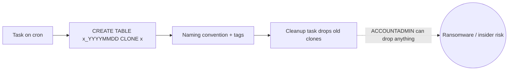
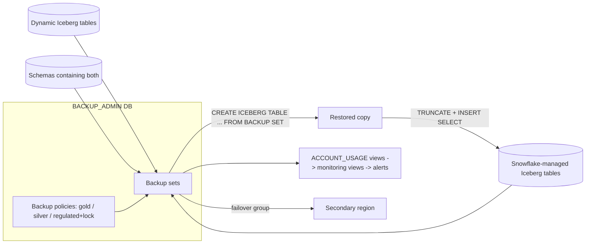

# Architecture

## Before: hand-rolled clones

## After: policy-driven backup sets

## Trust boundaries
| Role | Can | Cannot |
|---|---|---|
| BACKUP_ADMIN | create policies/sets, add/delete backups (unlocked) | apply locks, legal holds |
| BACKUP_OPERATOR | add backups, restore | create policies, delete backups |
| RETENTION_LOCK_ADMIN | create/apply locked policies | anything else |
| LEGAL_HOLD_ADMIN | add/remove legal holds | create/delete backups |
| BACKUP_AUDITOR | read monitoring views | change anything |
